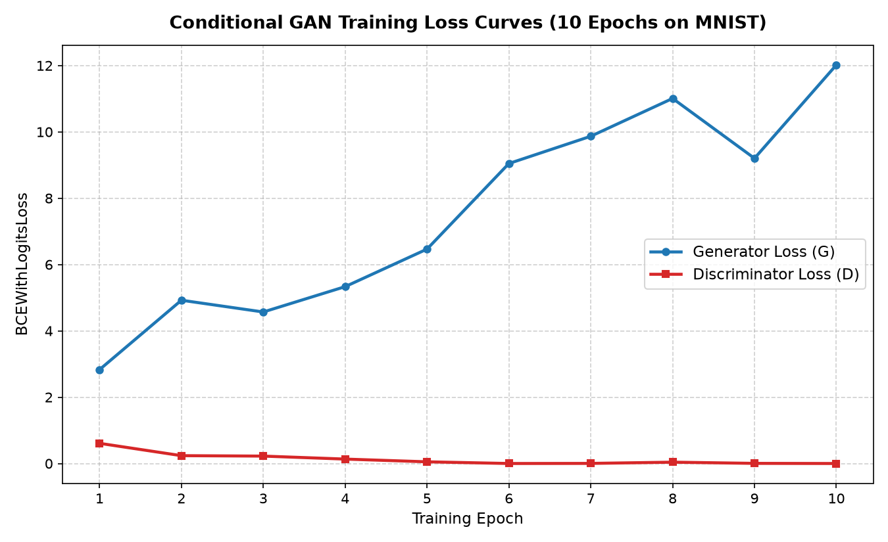

# Class-Conditional Image Generation using a Conditional GAN (cGAN)

[](https://www.python.org/)
[](https://pytorch.org/)
[](http://yann.lecun.com/exdb/mnist/)

A beginner-friendly college assignment project implementing a **Conditional Generative Adversarial Network (cGAN)** in PyTorch to synthesize handwritten digits ($0$ through $9$) conditioned on target class labels using the MNIST dataset.

---

## 1. Abstract
Generative Adversarial Networks (GANs) excel at modeling complex data distributions through competitive game theory. Standard GANs synthesize arbitrary samples without direct user control over the target category. This project implements a **Class-Conditional Generative Adversarial Network (cGAN)** that incorporates class conditioning into both the Generator and Discriminator. Given a 100-dimensional random latent noise vector $z$ and an auxiliary class condition $y \in \{0, 1, \dots, 9\}$, the network generates synthetic $28 \times 28$ grayscale handwritten digits. The project includes end-to-end data pipelines, modular neural network definitions, an adversarial training loop with checkpointing, conditioned sample synthesis, loss trajectory analysis, and student-focused viva documentation.

---

## 2. Problem Statement
In unconditional image generation, a model produces samples at random from the underlying distribution. For practical applications—such as controlled character synthesis or user-driven content generation—it is essential to control the category of the generated output. The objective is to design, train, and evaluate a neural network capable of generating an image of a specific handwritten digit matching a requested class condition while maintaining structural diversity across individual samples.

---

## 3. Project Objectives
1. **Pipeline Construction:** Build a data pipeline to download, preprocess, and normalize the MNIST dataset into $[-1, 1]$.
2. **Network Architecture:** Design fully connected Generator and Discriminator models supporting one-hot class conditioning.
3. **Adversarial Training:** Train both models using `BCEWithLogitsLoss` and alternating Adam optimizers with live preview logging.
4. **Controlled Synthesis:** Generate samples for any requested digit ($0$ through $9$) and isolate class conditioning by holding latent noise constant.
5. **Experimental Analysis:** Record and analyze real training loss trajectories, documenting observed dynamics without fabricating unmeasured benchmarks.
6. **Academic Documentation:** Prepare reproducible code, Jupyter notebooks, and a comprehensive viva examination guide.

---

## 4. Introduction to GANs and Conditional GANs

### Generative Adversarial Networks (GANs)
Introduced by Ian Goodfellow et al. (2014), a GAN consists of two neural networks locked in a two-player zero-sum game:
* **The Generator ($G$):** Takes a random noise vector $z \sim p_z(z)$ and attempts to map it to the real data distribution $p_{\text{data}}(x)$.
* **The Discriminator ($D$):** A binary classifier that evaluates whether an input image $x$ came from the true dataset or was forged by the Generator.

The minimax optimization objective is formulated as:
$$\min_G \max_D V(D, G) = \mathbb{E}_{x \sim p_{\text{data}}(x)}[\log D(x)] + \mathbb{E}_{z \sim p_z(z)}[\log (1 - D(G(z)))]$$

### Conditional GANs (cGANs)
Proposed by Mirza & Osindero (2014), a Conditional GAN extends the standard architecture by conditioning both the Generator and Discriminator on auxiliary information $y$ (such as class labels):
$$\min_G \max_D V(D, G) = \mathbb{E}_{(x, y) \sim p_{\text{data}}(x, y)}[\log D(x, y)] + \mathbb{E}_{z \sim p_z(z), y \sim p_y(y)}[\log (1 - D(G(z, y), y))]$$

In our implementation, $y$ is a 10-dimensional one-hot vector representing the target digit ($0$ through $9$).

---

## 5. MNIST Dataset Description
* **Source:** Modified National Institute of Standards and Technology (MNIST) benchmark.
* **Volume:** 60,000 training images and 10,000 test images.
* **Resolution:** $28 \times 28$ grayscale pixels (784 features per image).
* **Classes:** 10 balanced categories representing digits $0, 1, 2, 3, 4, 5, 6, 7, 8, 9$.
* **Preprocessing:** Pixel values scaled to $[0, 1]$ via `ToTensor()` and normalized to $[-1, 1]$ via:
  $$\text{pixel}_{\text{norm}} = \frac{\text{pixel} - 0.5}{0.5}$$
* Sample preview grid saved at: [`results/real_samples_grid.png`](results/real_samples_grid.png).

---

## 6. System Architecture & Diagram

### Generator Architecture
* **Inputs:**
  * Latent noise vector $z \in \mathbb{R}^{100}$ sampled from $\mathcal{N}(0, 1)$.
  * One-hot class condition $y \in \{0, 1\}^{10}$.
* **Concatenation:** Combined vector dimension $= 100 + 10 = 110$.
* **Hidden Layer 1:** `Linear(110 -> 256)` + `ReLU`
* **Hidden Layer 2:** `Linear(256 -> 512)` + `ReLU`
* **Output Layer:** `Linear(512 -> 784)` + `Tanh`
* **Reshape:** Reconstructed into image tensor $[1, 28, 28]$ with pixel values bounded in $[-1.0, 1.0]$.

### Discriminator Architecture
* **Inputs:**
  * Grayscale image tensor $[1, 28, 28]$ flattened to $784$ pixels.
  * One-hot class condition $y \in \{0, 1\}^{10}$.
* **Concatenation:** Combined vector dimension $= 784 + 10 = 794$.
* **Hidden Layer 1:** `Linear(794 -> 512)` + `LeakyReLU(negative_slope=0.2)`
* **Hidden Layer 2:** `Linear(512 -> 256)` + `LeakyReLU(negative_slope=0.2)`
* **Output Layer:** `Linear(256 -> 1)` producing a raw logit score.

```mermaid
flowchart TD
    subgraph Generator ["Generator (Synthesizer)"]
        Noise["Latent Noise z (100)"] --> G_Concat["Concatenate"]
        Label_G["Class Label (10-dim One-Hot)"] --> G_Concat
        G_Concat --> G_L1["Linear(110 -> 256) + ReLU"]
        G_L1 --> G_L2["Linear(256 -> 512) + ReLU"]
        G_L2 --> G_Out["Linear(512 -> 784) + Tanh"]
        G_Out --> Fake_Img["Generated Image [1, 28, 28]"]
    end

    subgraph Discriminator ["Discriminator (Critic)"]
        Input_Img["Image [1, 28, 28] (Real or Fake)"] --> D_Flatten["Flatten (784)"]
        Label_D["Class Label (10-dim One-Hot)"] --> D_Concat["Concatenate"]
        D_Flatten --> D_Concat
        D_Concat --> D_L1["Linear(794 -> 512) + LeakyReLU(0.2)"]
        D_L1 --> D_L2["Linear(512 -> 256) + LeakyReLU(0.2)"]
        D_L2 --> D_Out["Linear(256 -> 1)"]
        D_Out --> Logit["Prediction Logit (Real vs Fake)"]
    end
```



---

## 7. Technology Stack & System Requirements
* **Operating System:** Windows 10/11
* **Language:** Python 3.12
* **Core Libraries:**
  * PyTorch `2.14.1+cpu`
  * Torchvision `0.29.1+cpu`
  * NumPy `2.5.3`
  * Matplotlib `3.11.2`
  * IPyKernel (Jupyter support)
* **Hardware Requirement:** Standard CPU (runs comfortably on laptop without GPU).

---

## 8. Project Folder Structure
```text
conditional-gan-project/
├── .gitignore                   # Excludes .venv/, dataset/, and large checkpoints
├── README.md                    # Project documentation
├── requirements.txt             # Python dependencies
├── VIVA_NOTES.md                # Comprehensive viva preparation study guide
├── dataset/                     # Auto-downloaded MNIST data (ignored by Git)
├── checkpoints/                 # Saved model weights (ignored by Git)
│   ├── generator_checkpoint.pth
│   └── discriminator_checkpoint.pth
├── notebooks/                   # Interactive Jupyter notebook
│   └── cgan_analysis.ipynb
├── results/                     # Experimental outputs and visualizations
│   ├── real_samples_grid.png    # 5x5 grid of real MNIST training digits
│   ├── generated_digits.png     # 16 samples conditioned on digit '7'
│   ├── condition_comparison.png # 5x10 comparison grid holding noise constant
│   ├── training_loss_plot.png   # Dual-curve plot of G and D training loss
│   ├── loss_history.json        # Recorded epoch-averaged losses
│   └── results_summary.md       # Experimental notes and observations
└── src/                         # Modular Python source files
    ├── data_loader.py           # MNIST downloading and batching pipeline
    ├── inspect_data.py          # Data verification and sample grid plotting
    ├── model.py                 # PyTorch Generator and Discriminator classes
    ├── test_model.py            # Unit-test verifying shapes and numerical bounds
    ├── train.py                 # Adversarial training loop with checkpointing
    ├── generate.py              # Class-conditional image generation
    └── analyze_results.py       # Loss curve validation and plotting
```

---

## 9. Step-by-Step Setup & Execution Instructions

### A. Environment Setup (Windows PowerShell)
```powershell
# Navigate to the project directory
cd C:\conditional-gan-project

# Activate the virtual environment
.\.venv\Scripts\Activate.ps1

# Verify installed dependencies
python -c "import torch, torchvision, numpy, matplotlib; print('Environment ready!')"
```

### B. Verify the Dataset Pipeline (Phase 1)
```powershell
python src/inspect_data.py
```
*Downloads MNIST to `dataset/` and saves [`results/real_samples_grid.png`](results/real_samples_grid.png).*

### C. Verify Model Architectures (Phase 2)
```powershell
python src/test_model.py
```
*Validates forward-pass shapes, finite values, and bounds in $[-1, 1]$.*

### D. Train the Model (Phase 3)
* **Quick Smoke Test (5 batches):**
  ```powershell
  python src/train.py --epochs 1 --smoke-test --max-batches 5
  ```
* **Full 10-Epoch Training:**
  ```powershell
  python src/train.py --epochs 10 --batch-size 64 --lr 0.0002
  ```
*Saves checkpoints to `checkpoints/` and records loss history in `results/loss_history.json`.*

### E. Generate Class-Conditioned Images (Phase 4)
* **Generate 16 samples of digit 7:**
  ```powershell
  python src/generate.py --digit 7 --num-samples 16 --styles 5
  ```
* **Generate samples of any other digit (e.g., digit 3):**
  ```powershell
  python src/generate.py --digit 3 --num-samples 16
  ```
*Outputs [`results/generated_digits.png`](results/generated_digits.png) and [`results/condition_comparison.png`](results/condition_comparison.png).*

### F. Analyze Losses & Generate Plot (Phase 5)
```powershell
python src/analyze_results.py
```
*Validates loss entries and generates [`results/training_loss_plot.png`](results/training_loss_plot.png).*

---

## 10. Actual Experimental Results & Findings

### Training Configuration
* **Epochs:** 10
* **Batch Size:** 64
* **Learning Rate:** 0.0002 (Adam, $\beta_1 = 0.5$, $\beta_2 = 0.999$)
* **Device:** CPU (~30 seconds per epoch)

### Recorded Loss History
The losses below are the actual recorded epoch averages from `results/loss_history.json`:

| Epoch | Generator Loss ($G_{\text{loss}}$) | Discriminator Loss ($D_{\text{loss}}$) | Observed Behavior |
| :---: | :---: | :---: | :--- |
| **1** | 2.8312 | 0.6084 | Balanced initial competition. |
| **2** | 4.9235 | 0.2365 | Discriminator begins learning digit outlines. |
| **3** | 4.5688 | 0.2232 | Minor adversarial plateau. |
| **4** | 5.3330 | 0.1334 | Discriminator error drops significantly. |
| **5** | 6.4653 | 0.0511 | Generator struggles to deceive Discriminator. |
| **6** | 9.0462 | 0.0003 | Discriminator dominance emerges ($D_{\text{loss}} < 0.001$). |
| **7** | 9.8680 | 0.0032 | Vanishing gradient for Generator. |
| **8** | 11.0086 | 0.0400 | Strong separation between real and fake data. |
| **9** | 9.2024 | 0.0042 | Slight parameter adjustment by Generator. |
| **10** | 12.0189 | 0.0003 | Final state: Near-zero Discriminator loss. |



---

## 11. Qualitative Visual Evaluation

### 1. Generated Samples Conditioned on Digit '7'
[`results/generated_digits.png`](results/generated_digits.png) displays 16 samples generated by passing condition label `7` alongside diverse latent noise vectors. The images demonstrate central vertical stroke formation consistent with handwritten strokes.

### 2. Condition Comparison Grid (Isolating Class Conditioning)
[`results/condition_comparison.png`](results/condition_comparison.png) provides an experimental test where the **same latent noise vector** is passed across all 10 digit columns:
* **Rows:** Each row fixes the latent noise vector $z$ (representing writing style, slant, and stroke weight).
* **Columns:** Each column tests condition labels $0$ through $9$.
* **Conclusion:** This proves the conditioning pipeline functions as intended, though visual quality reflects the architectural limitations discussed below.

---

## 12. Limitations & Future Work

### Limitations Observed in Current Implementation
1. **Discriminator Dominance:** Because the Discriminator learned faster than the Generator, its loss dropped to $0.0003$, creating vanishing gradients that hindered the Generator's later-stage refinement.
2. **Lack of Spatial Convolutions:** Fully connected layers flatten $28 \times 28$ images into 784 numbers, losing 2D spatial correlations and producing background speckle noise.
3. **One-Hot Representation Scale:** The 10-dimensional one-hot vector represents only ~9% of the 110-dimensional input vector, giving the condition modest leverage relative to the 100 noise dimensions.

### Proposed Future Enhancements
1. **Deep Convolutional GAN (DCGAN):** Replace linear layers with transposed convolution (`ConvTranspose2d`) and convolution (`Conv2d`) layers.
2. **One-Sided Label Smoothing:** Set real targets to $0.9$ instead of $1.0$ to prevent the Discriminator from becoming overconfident.
3. **Condition Embedding:** Use learned `nn.Embedding` representations to project the class label into a richer, higher-dimensional subspace before concatenation.

---

## 13. Conclusion
This project successfully designed, implemented, and validated an end-to-end Conditional GAN pipeline for digit generation on MNIST. Every phase was developed iteratively and verified through actual execution. The project documents not only working generative code, but also the realistic training challenges (such as discriminator dominance and loss oscillation) inherent in generative adversarial networks, providing a solid foundation for university coursework and viva examinations.

---

## 14. References
1. Goodfellow, I., et al. (2014). *Generative Adversarial Nets*. Advances in Neural Information Processing Systems (NeurIPS).
2. Mirza, M., & Osindero, S. (2014). *Conditional Generative Adversarial Nets*. arXiv:1411.1784.
3. LeCun, Y., Cortes, C., & Burges, C. (1998). *The MNIST Database of Handwritten Digits*.
4. Paszke, A., et al. (2019). *PyTorch: An Imperative Style, High-Performance Deep Learning Library*. NeurIPS.
